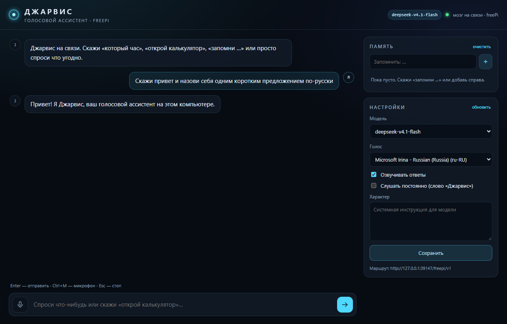

# Джарвис

Голосовой ассистент на компьютере: спрашиваешь вслух - отвечает вслух и открывает
программы. Работает **без Ollama**: «мозгом» служит локальный маршрут freePi из
Andrey DS Harness, поэтому ничего скачивать и настраивать не нужно.

```
микрофон  ->  Vosk (локально, без интернета)  ->  JARVIS  ->  freePi (127.0.0.1:39147)  ->  ответ голосом
```



## Быстрый старт

1. Запустите **Andrey DS Harness** и проверьте, что аккаунт freePi на месте (меню «…» -> «Аккаунты»).
2. Двойной клик по `jarvis.cmd` (или `npm start`, или `node server.mjs`).
3. Откроется браузер с Джарвисом. Разрешите микрофон, если спросит.
4. Просто говорите: «Привет, Андрей, который час». Кнопка микрофона и `Ctrl+M` - для ручного режима.

Речь распознаётся **локально** (Vosk), интернет для этого не нужен. Если Python-модуль
или модель ещё не стоят, запустите один раз: `powershell -ExecutionPolicy Bypass -File tools/setup-stt.ps1`
(или вручную: `python -m pip install vosk` и распаковка модели в `models/`). Без модели
Джарвис откатится на встроенное распознавание браузера.

Страница живёт на `http://127.0.0.1:7788` (если порт занят, Джарвис возьмёт следующий).
Ключи и токены вводить не нужно: маршрут freePi локальный, доступ он проверяет сам.

## Что умеет без модели (мгновенно)

| Скажите | Что произойдёт |
|---|---|
| «который час», «какое сегодня число» | ответит временем и датой |
| «открой блокнот / калькулятор / проводник / word / excel» | запустит программу |
| «открой ютуб / github / yandex.ru» | откроет сайт в браузере |
| «запомни купить молоко» | запишет в память (панель справа) |
| «покажи заметки», «очисти заметки» | продиктует или очистит память |
| «таймер на 5 минут» | отсчитает и скажет, что время вышло |
| «сколько памяти», «какая загрузка процессора» | покажет состояние машины |
| «стоп», Escape | выключит озвучку и остановит ответ |

Всё остальное уходит модели freePi: обычные вопросы, объяснения, код, советы.

## Голос

- **Распознавание** - локально, модель Vosk `vosk-model-small-ru-0.22` (папка `models/`).
  Работает в любом браузере, без интернета и без сервисов Google: в Brave, где Web Speech
  часто падает с ошибкой `network`, это единственный надёжный вариант. Если модели нет -
  используется запасной путь через Web Speech API (Chrome/Edge).
- **Озвучка** - системные голоса Windows через `speechSynthesis`; голос выбирается в настройках.
  Рядом с выбором голоса есть ссылка «проверить голос».
- **Микрофон** - выбирается в настройках (например, микрофон ноутбука, пока звук идёт в
  Bluetooth-наушники). Под чатом есть полоска уровня: если она не шевелится, когда вы
  говорите, выбран не тот микрофон или в Windows занижена его громкость.
- **Без обращения** - галочка в настройках: реагировать на любую фразу, не дожидаясь
  «Привет, Андрей» / «Джарвис». По умолчанию выключено.
- **Слушает всегда** - включено по умолчанию. Достаточно сказать вслух:
  - «Привет, Андрей, который час»
  - «Джарвис, открой ютуб»
  - «Андрей, запомни купить молоко»

  Слова-обращения: «Привет, Андрей», «Андрей», «Джарвис», «Jarvis». Дальше идёт обычная
  команда. Если сказать только «Привет, Андрей» - ответит «Слушаю, Андрей».
  Фразы без обращения игнорируются, чтобы ассистент не отвечал на посторонний разговор.
  Микрофон поднимается сам при открытии страницы; если браузер не даёт доступ,
  достаточно один раз кликнуть по странице или по кнопке микрофона.
  Отключается галочкой «Слушать всегда» в настройках или `Ctrl+M`.

Если хочется лучший русский голос, поставьте любой SAPI5-голос в систему - он появится в списке.

## Настройки

Панель справа: модель (список берётся с маршрута freePi), голос, автоозвучка,
постоянное слушание и «характер» - системная инструкция для модели. Всё хранится в
`data/settings.json`, заметки - в `data/memory.json`.

## Другой мозг

Джарвис говорит на языке OpenAI API, поэтому маршрут можно заменить в `.env`:

```ini
JARVIS_BASE_URL=https://api.groq.com/openai/v1
JARVIS_MODEL=llama-3.3-70b-versatile
JARVIS_API_KEY=gsk_...
```

Без `JARVIS_BASE_URL` приложение само ищет freePi на портах `39147..39156`.
Ключ не нужен, пока используется Andrey DS Harness.

## Структура

```
Jarvis/
  jarvis.cmd            запуск в один клик
  server.mjs            HTTP-сервер: статика, SSE-чат, заметки, открытие программ
  src/llm.mjs           клиент freePi: поиск маршрута, модели, стриминг
  src/sse.mjs           разбор потока server-sent events
  src/assistant.mjs     локальные команды, память, системный промпт
  src/store.mjs         заметки и настройки в JSON
  src/stt.mjs           локальное распознавание: python-воркер + события
  stt/stt_worker.py     Vosk-воркер: PCM16 16 кГц со stdin -> текст в stdout
  models/               модель Vosk (не в git, ставится скриптом)
  public/               страница: чат, микрофон, озвучка, панель
  tools/smoke.mjs       самопроверка логики без сети
  tools/setup-stt.ps1   установка Python-модуля vosk и русской модели
  data/                 появится после запуска: память, настройки, журнал
```

Зависимостей npm нет, `npm install` не нужен. Требуется Node.js 20+.
Для локального распознавания - Python 3 и пакет `vosk` (ставится скриптом).

## Проверка

```
node --check server.mjs
node tools/smoke.mjs
```

## Если что-то не так

- **«Маршрут freePi недоступен»** - не запущен Andrey DS Harness или в нём нет аккаунта
  freePi. Запустите приложение и обновите страницу.
- **Микрофон молчит** - проверьте `http://127.0.0.1:7788/api/stt/status`: там видно,
  нашлась ли модель (`available`). Если нет - запустите `tools/setup-stt.ps1`. Разрешение
  на микрофон выдаётся в адресной строке (иконка замка); после ответа браузера страницу
  достаточно перезагрузить.
- **Нет звука** - в Windows нет русского голоса: Параметры -> Время и язык -> Речь ->
  Добавить голоса.
- **Плохо слышит в Bluetooth-гарнитуре** - режим «Hands-Free» у гарнитуры узкополосный и
  тихий. Варианты: выбрать в настройках Джарвиса микрофон ноутбука (звук ответа останется
  в наушниках) или поднять уровень: Параметры -> Система -> Звук -> Ввод -> ваша гарнитура
  -> громкость 100%. Тихий сигнал Джарвис дополнительно усиливает сам.
- **Порт занят** - Джарвис сам берёт следующий свободный; адрес печатается в консоли.

